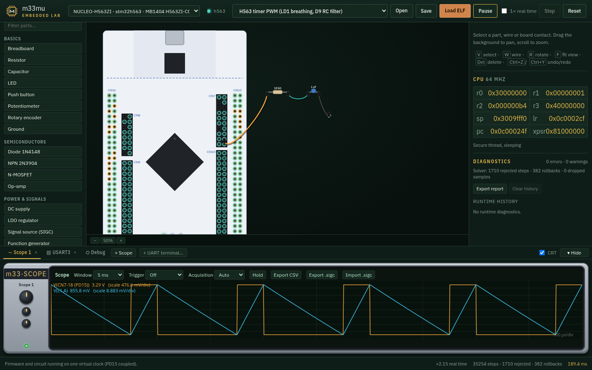
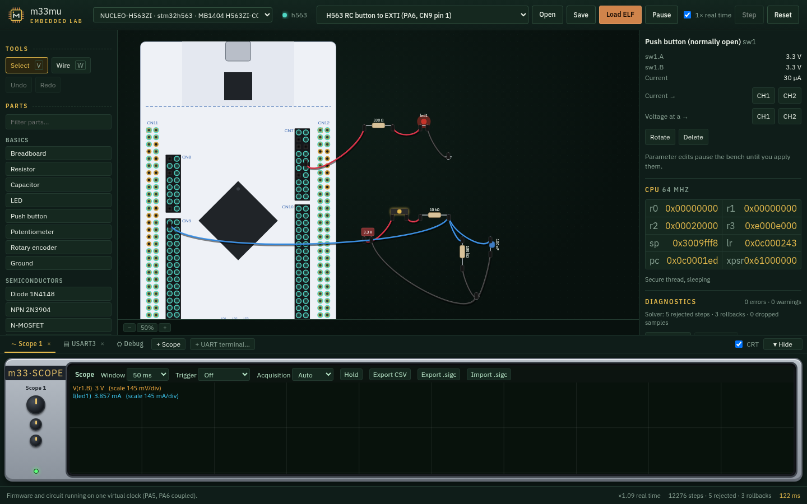
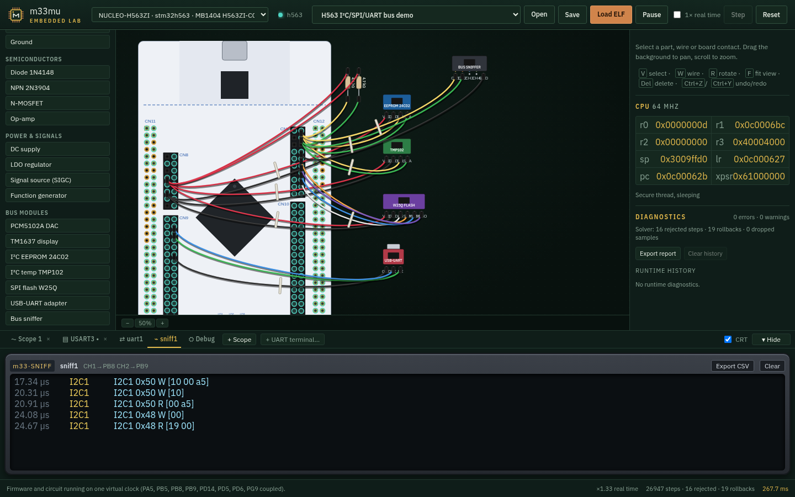
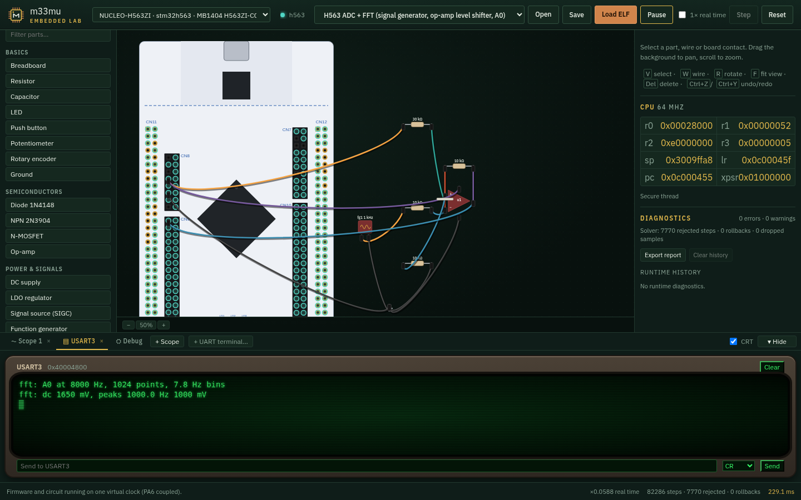
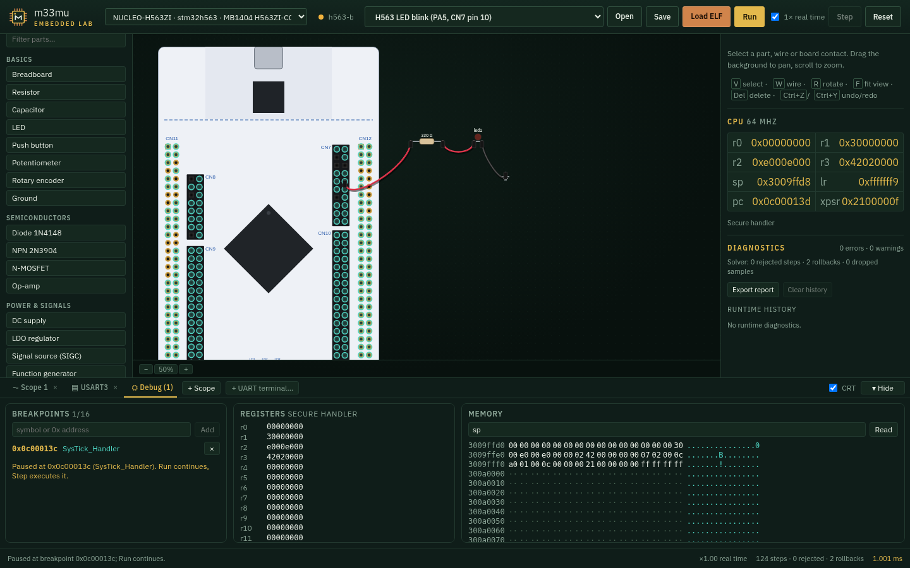

# m33mu Embedded Lab

**Run firmware. Wire a circuit. Watch both respond on the same virtual clock.**

The Lab is a browser workbench for [m33mu](https://github.com/danielinux/m33mu), an Armv8-M emulator compiled to WebAssembly. Load an ELF, connect parts to a board's header pins, and see GPIO, interrupts, buses and analog signals interact as the firmware runs. A scope, UART terminals, bus sniffer and debugger are built into the bench.



*A real STM32H563 firmware image drives TIM4 PWM into a wired RC filter. The scope shows the PWM edge and the filtered voltage.*

## Try it in a minute

1. Build and start the Lab using the commands below, then open **http://127.0.0.1:5173/**.
2. Pick **H563 timer PWM** from **Examples…** and press **Run**. The on-board LED breathes while the scope shows the PWM and filtered output.
3. Try **H563 RC button to EXTI**. Hold the switch on the canvas: its capacitor charges, the MCU sees an interrupt, and the LED responds.
4. Try **H563 I²C/SPI/UART bus demo**. Open the sniffer and terminal tabs; remove an I²C pull-up to see a bus fault reach the firmware.

The examples include their firmware and wiring, so you can start by exploring and then edit the circuit. You can also load your own ELF, wire from the parts palette, and save the whole bench as a project.

## See the Lab in action

| Firmware meets a circuit | Buses you can inspect |
| --- | --- |
| [](docs/screenshots/04-button-pressed.png) | [](docs/screenshots/08-bus-sniffer.png) |
| Hold the RC switch: the voltage crosses the input threshold, EXTI fires, and the LED lights. | Watch EEPROM and temperature sensor transactions, UART output and wiring dependent bus faults. |
| **Analog input to firmware** | **Pause inside the MCU** |
| [](docs/screenshots/13-adc-fft.png) | [](docs/screenshots/11-debugger.png) |
| A function generator and op-amp feed the ADC; firmware prints the measured spectrum. | Break on a symbol, inspect registers and memory, then continue the same bench run. |

The board picker covers **15 m33mu CPU profiles**, including STM32, RP2350, Nordic, NXP and Microchip targets. The [Pico 2 GPIO example](docs/screenshots/12-pico2-gpio.png) shows the same workbench on a different board. The NUCLEO-H563ZI drawing has a reviewed Zio and morpho pin map, including 212 wired contacts and explanations for visual-only contacts.

## What's on the bench

- **Parts and wiring:** breadboard, passive parts, switches, semiconductors, op-amp, signal generator, power sources and logic-level I²C/SPI/UART devices. Place, rotate, wire, pan, zoom, undo and redo.
- **Firmware and circuits together:** GPIO and EXTI use solved pad voltages; STM32H5 timer PWM and ADC connect firmware to the analog solver. UART terminals, bus sniffers and fault injection make I/O visible.
- **Instruments:** multiple two-channel scopes with triggers, cursors and CSV/SIGC capture tools; an inspector, diagnostics and a symbol-aware debugger.
- **Security demos:** on-chip crypto engines and wired ATECC608A, TA100, TROPIC01, SE050 and STSAFE-A120 models. Browser secure-element support needs the optional crypto build described in [crypto.md](docs/crypto.md).
- **Portable projects:** version 2 JSON saves the circuit, probes, solver settings, view and an embedded ELF verified by SHA-256. More examples live in [`public/examples/`](public/examples/).

For exact support and limits, see [current capabilities](docs/current-capabilities.md). The [electrical model](docs/electrical-model.md), [bus model](docs/buses.md) and [PWM notes](docs/pwm.md) explain how the bench behaves.

## Build and run

You need CMake, Emscripten (`emcc` and `emcmake`), Node.js/npm and the [m33mu native build dependencies](m33mu/README.md).

```sh
git submodule update --init
cmake -S . -B build
cmake --build build
cmake --build build --target webserver
```

The server starts Vite at **http://127.0.0.1:5173/**. The build also writes a standalone app to `dist/`. For the browser crypto models, configure with `-DM33MU_WOLFSSL_SRC=/path/to/wolfssl`; add `-DM33MU_WASM_RUST_SE=ON` for the Rust secure elements. You can use `scripts/build-web-app.sh --install && npm run dev` instead of the CMake webserver target. `M33MU_ROOT` lets the scripts use another m33mu checkout.

## Verify a build

```sh
cd build && ctest --output-on-failure
```

The suite covers the solver, project model, WASM worker, firmware/circuit timing, demos and Chromium interaction. Firmware tests need `arm-none-eabi-gcc`; the browser test needs Chromium (`M33MU_CHROMIUM` overrides its path). Run `scripts/test-web-browser.sh docs/screenshots` from the repository root to recapture the browser scenarios. For a saved project's headless run, use `node scripts/run-project.mjs PROJECT.m33mu.json --ns N --expect-uart REGEX`.

The app is in `src/`, the emulator worker in `worker/`, the solver in `sim/`, board data and art in `boards/` and `public/boards/`, and the emulator itself in the `m33mu/` submodule. The worker checks its WASM ABI version before starting a session.

## License

AGPL-3.0-or-later, as m33mu. See [LICENSE](LICENSE) and [third-party notices](THIRD_PARTY.md).
